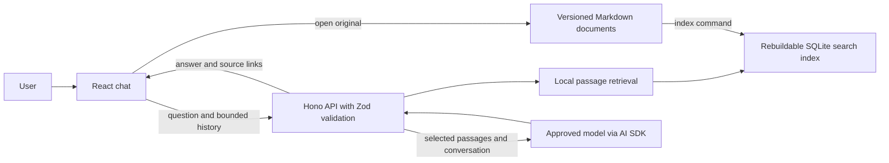

# Architecture

Markdown files are the canonical source; a local SQLite index is derived and can be deleted and rebuilt. A deterministic metadata mapping associates document IDs with the fixed files and their GitHub original URLs. Retrieval starts with lexical search over passages; embeddings are not required for the MVP. Test retrieval against the evaluation cases before adding complexity. The index is a derived runtime artifact, not a committed database or replacement for the source documents.

The API receives the current question and at most ten prior question/answer turns. It uses history to interpret follow-ups and searches the corpus for each question. If evidence is insufficient or ambiguous, it returns a grounded clarification or insufficient-information response. If a provider cannot safely establish support, avoid a confident unsupported claim. No model can guarantee correctness; evaluate results against source passages. Cite only documents returned by retrieval and validate cited IDs before returning them.

The browser holds the conversation in memory; refreshing or starting a new conversation clears it. The backend does not persist chat messages. For source links, map the allowlisted document IDs to `https://github.com/luisleitonflores09/ai-first-team-9/blob/main/knowledge/<filename>`; users must have GitHub access. Before upload these links do not yet resolve. The model receives synthetic passages and limited conversation history, so a local UI does not imply local inference. Provider approval, location and costs are not established.

## Boundaries

Use React/TypeScript with Vike, Bun/Hono, Zod and AI SDK as the program's recommendations. Use SQLite with Bun's built-in driver and Drizzle for the minimal local index if the chosen search implementation needs it; no authentication or permission filtering is claimed. Limit request size and handle provider/retrieval failures. Documents are untrusted content: treat their instructions as data, not commands. See [ADR 001](decisions/001-stack-and-storage.md).
