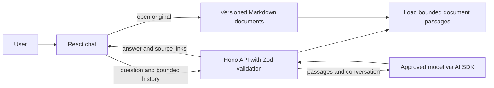

# Architecture

Markdown files are the canonical source. A deterministic metadata mapping associates document IDs with the fixed files and their GitHub original URLs. For this small fixed corpus, load the document passages and send the bounded collection to the model so it can consider relevant information even when words differ. Enforce a documented size limit; if the collection exceeds it, return a clear error rather than silently dropping sources. Evaluate different-word questions before deciding whether a separate semantic index is necessary. The approach does not guarantee a correct match.

The API receives the current question and at most ten prior question/answer turns. It uses history to interpret follow-ups and searches the corpus for each question. If evidence is insufficient or ambiguous, it returns a grounded clarification or insufficient-information response. If a provider cannot safely establish support, avoid a confident unsupported claim. No model can guarantee correctness; evaluate results against source passages. Cite only documents returned by retrieval and validate cited IDs before returning them.

The browser holds the conversation in memory; refreshing or starting a new conversation clears it. The backend does not persist chat messages. For source links, map the allowlisted document IDs to `https://github.com/luisleitonflores09/ai-first-team-9/blob/main/knowledge/<filename>`; users must have GitHub access. Before upload these links do not yet resolve. The model receives synthetic passages and limited conversation history, so a local UI does not imply local inference. Provider approval, location and costs are not established.

## Boundaries

Use React/TypeScript with Vike, Bun/Hono, Zod and AI SDK for the first version. SQLite and Drizzle are available if an index becomes necessary; the first version has no authentication or permission filtering. Limit request and corpus size and handle provider/retrieval failures. Documents are untrusted content: treat their instructions as data, not commands. See [ADR 001](decisions/001-stack-and-storage.md).
